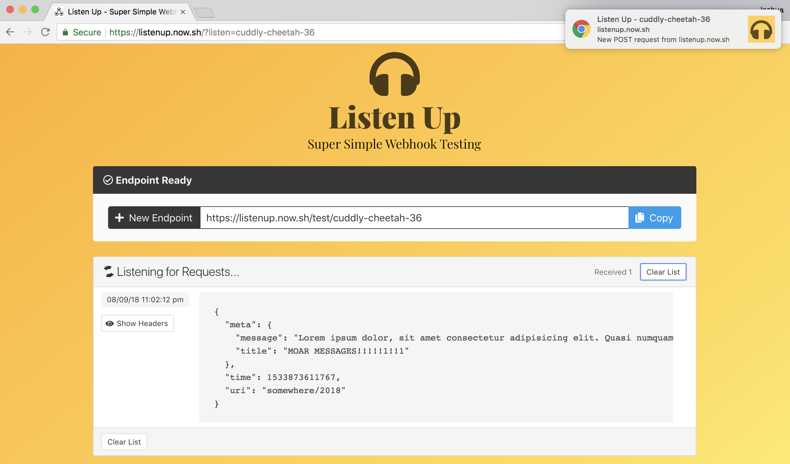

Developer Note: While this tool has been useful, I am not longer maintaining it and am going to pursue building a more robust successor to this app. Thank you to all who have used it over the years and encouraged me to continue working on it.

# NOTE FROM DEVELOPER:
I no longer work on this project, but have moved on to work on a successor platform. If you're looking for a quick solution with persistent data that will get you up and running quickly, you can [check out the new HeyListenUp](https://heylistenup.app/).

# listen-up

> Super Simple Webhook Listeners



## About

**Listen Up** is a very rudimentary webhook listening platform that will display your `POST` requests to generated endpoints in realtime. This is meant to be useful for prototyping and developing [webhooks](https://en.wikipedia.org/wiki/Webhook).

You can run it locally and tunnel your requests (using [ngrok](https://ngrok.com/)) to port 3030 to see them come through. Or you can deploy it to a platform like hosting platform.


## Tooling

This project uses:

- [Feathers](http://feathersjs.com). An open source web framework for building simple real-time applications - used on the back-end and front-end
- [Vue](https://vuejs.org) for some front-end (is currently rudimentary)
- [Tailwind](https://tailwindcss.com) for a fantastic utility-class css framework
- Atlas for hosting a simple hobby instance of MongoDB

## Data Handling and Storage

MongoDB Data for the post requests is not persisted past 60 seconds. Webhook endpoints will expire after 48 hours if they are not used.

## TODO:

There are a couple things I'd like to do yet with this small project.

- UI Improvements
  - Improve Notification system

## Getting Started

1. Make sure you have [NodeJS](https://nodejs.org/) and [npm](https://www.npmjs.com/) installed.
2. Install your dependencies

   ```
   cd path/to/listen-up;

   npm install
   ```

3. Start your app

   ```
   npm start
   ```

To test and Develop Locally you will need a MongoDB instance running locally at `mongodb://localhost:27017/listen_up`.

## Pull Requests

Sure. If you want to make it better. But really this is just for helping me test and deal with webhooks with work projects.

## Help

For more information on all the things you can do with Feathers visit [docs.feathersjs.com](http://docs.feathersjs.com).

## License

Copyright (c) 2018-2023

Licensed under the [MIT license](LICENSE).
